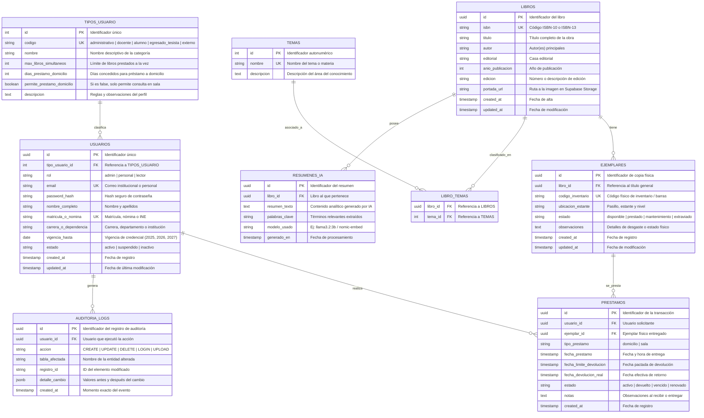

# 🏛️ Documento de Arquitectura de Software y Diagrama Entidad-Relación (ER)
## Proyecto: Sistema de Gestión Bibliotecaria (Sistema de Acervo CIU)

---

## 1. Visión General y Arquitectura del Sistema

El **Sistema de Gestión Bibliotecaria (Sistema de Acervo CIU)** se fundamenta en una **Arquitectura Moderna Desacoplada Basada en Microservicios y Fullstack BFF (Backend-for-Frontend)**:

1. **Núcleo Fullstack (Next.js + TypeScript):** Gestiona la presentación visual (React), la lógica de negocio central, la API REST interna (Next.js App Router / Route Handlers), la autenticación de usuarios, el control de acceso por roles (RBAC), el inventario, los préstamos, la subida de portadas a Supabase Storage y el registro de bitácora de auditoría.
2. **Microservicio Especializado de IA (Python 3.12 + FastAPI):** Encapsula exclusivamente las tareas de Inteligencia Artificial (procesamiento del lenguaje natural, síntesis y resúmenes automáticos de libros con LLM local Ollama `llama3.2:3b` y generación de embeddings con `nomic-embed-text`).
3. **Capa de Persistencia y Almacenamiento (Supabase / PostgreSQL):** Base de datos relacional robusta con soporte para políticas *Row Level Security* (RLS), triggers automáticos y almacenamiento en la nube (Storage buckets) para portadas de libros.

```
┌────────────────────────────────────────────────────────────────────────┐
│             NÚCLEO FULLSTACK: NEXT.JS 14+ CON TYPESCRIPT               │
│                                                                        │
│   ┌────────────────────────────────────────────────────────────────┐   │
│   │               CAPA DE PRESENTACIÓN (CLIENTE UI)                │   │
│   │  ├── Catálogo y Búsqueda Inteligente de Libros                 │   │
│   │  ├── Panel de Préstamos y Devoluciones                         │   │
│   │  ├── Panel de Control de Inventario y Ejemplares Físicos       │   │
│   │  └── Dashboard de Métricas y Estadísticas                      │   │
│   └───────────────────────────────┬────────────────────────────────┘   │
│                                   │ Fetch / Server Actions             │
│   ┌───────────────────────────────▼────────────────────────────────┐   │
│   │           CAPA DE SERVICIOS Y API (ROUTE HANDLERS)             │   │
│   │  ├── /api/auth    -> Login, validación de sesiones y roles     │   │
│   │  ├── /api/books   -> CRUD completo de libros y ejemplares      │   │
│   │  ├── /api/loans   -> Transacciones de préstamo y devolución    │   │
│   │  ├── /api/users   -> Gestión de usuarios (alumno, personal)    │   │
│   │  ├── /api/audit   -> Consulta de bitácora y auditoría          │   │
│   │  ├── /api/storage -> Subida de portadas (Supabase Storage)     │   │
│   │  └── /api/ai      -> Orquestación y consumo de servicios IA    │   │
│   └──────────────────────┬─────────────────────────┬───────────────┘   │
└──────────────────────────┼─────────────────────────┼───────────────────┘
                           │                         │
     PostgreSQL / RLS / SDK│                         │ HTTP REST (JSON)
                           │                         │
┌──────────────────────────▼───────────┐ ┌───────────▼───────────────────┐
│       BASE DE DATOS & STORAGE        │ │    MICROSERVICIO DEDICADO DE  │
│              Supabase                │ │        IA LOCAL (PYTHON)      │
│  ├── PostgreSQL 15+ (Relacional)     │ │  FastAPI + Ollama Engine      │
│  ├── Row Level Security (RLS)        │ │  ├── Modelo: Llama 3.2 (3B)   │
│  ├── Supabase Storage (Portadas)     │ │  ├── Resúmenes Analíticos     │
│  └── Tablas: Libros, Usuarios,       │ │  ├── Sugerencias Temáticas    │
│      Ejemplares, Préstamos, Logs     │ │  └── Embeddings Vectoriales   │
└──────────────────────────────────────┘ └───────────────────────────────┘
```

---

## 2. Stack Tecnológico Seleccionado

| Componente | Tecnología | Justificación Técnica |
| :--- | :--- | :--- |
| **Núcleo Fullstack & API** | Next.js 14+ / TypeScript | Tipado estático de extremo a extremo, soporte para Server Components, App Router y Route Handlers (`/api/...`) de alto rendimiento para toda la lógica de negocio. |
| **Base de Datos Relacional** | Supabase (PostgreSQL 15+) | Motor ACID de grado empresarial, llaves foráneas con integridad referencial, índices optimizados y seguridad a nivel de fila (*Row Level Security*). |
| **Almacenamiento de Archivos** | Supabase Storage | Bucket dedicado (`portadas`) con generación de URLs públicas y control de subidas de archivos multipart. |
| **Microservicio de IA** | Python 3.12 + FastAPI + Ollama | Entorno especializado para LLMs y procesamiento de lenguaje natural local (`llama3.2:3b` y `nomic-embed-text`) con costo de inferencia $0 y privacidad institucional absoluta. |
| **Control de Auditoría** | Bitácora en BD (`auditoria_logs`) | Registro inmutable de eventos que almacena quién ejecutó la acción, en qué tabla, sobre qué ID y con qué valores antes/después. |

---

## 3. Modelo Entidad-Relación (ER)

### 3.1 Diagrama Entidad-Relación (Mermaid)


