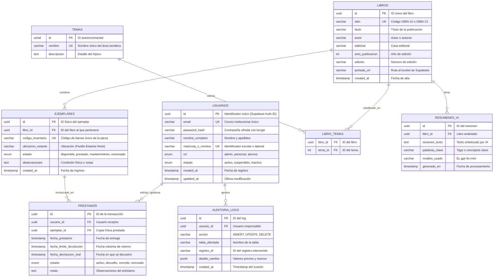

# 🏛️ Documento de Arquitectura de Software y Diagrama Entidad-Relación (ER)
## Proyecto: Sistema de Gestión Bibliotecaria (Sistema de Acervo CIU)

---

## 1. Visión General y Arquitectura del Sistema

El **Sistema de Gestión Bibliotecaria** se concibe bajo una **Arquitectura en Capas Desacoplada (Headless / Decoupled Client-Server)**, que maximiza la modularidad, escalabilidad, seguridad y mantenibilidad.

```
┌────────────────────────────────────────────────────────────────────────┐
│                        CAPA DE PRESENTACIÓN                            │
│                 React 19 + TypeScript / Vite / NextJS                  │
│  ├── Portal Web / Catálogo de Libros (Alumnos y Docentes)              │
│  ├── Gestión de Préstamos y Devoluciones (Personal)                   │
│  └── Dashboard Administrativo y Estadísticas                           │
└───────────────────────────────────┬────────────────────────────────────┘
                                    │ HTTPS / REST (JSON)
┌───────────────────────────────────▼────────────────────────────────────┐
│                        CAPA DE SERVICIOS (BACKEND)                     │
│                           Python 3.12 + FastAPI                        │
│  ├── API Gateway & Routers (/auth, /books, /loans, /users, /ai)        │
│  ├── Capa de Seguridad (OAuth2 + JWT Bearer + RBAC)                    │
│  ├── Middleware de Auditoría y Bitácora                                │
│  └── Orquestador de Servicios IA (Embeddings & Resúmenes)              │
└──────────────────┬─────────────────────────────────┬───────────────────┘
                   │                                 │
   PostgreSQL Driver / PostgREST                     │ SDK Asíncrono
                   │                                 │
┌──────────────────▼───────────────────┐ ┌───────────▼───────────────────┐
│       BASE DE DATOS & STORAGE        │ │    SERVICIOS DE INTELIGENCIA  │
│              Supabase                │ │        ARTIFICIAL LOCAL       │
│  ├── PostgreSQL 15+ (Relacional)     │ │  Ollama / Local LLM Server    │
│  ├── Row Level Security (RLS)        │ │  ├── Modelo: Llama 3.2 / Qwen │
│  ├── Supabase Auth (Identity)        │ │  ├── Búsqueda Semántica Local │
│  └── Supabase Storage (Portadas)     │ │  └── Síntesis y Resúmenes     │
└──────────────────────────────────────┘ └───────────────────────────────┘
```

---

## 2. Stack Tecnológico Seleccionado

| Componente | Tecnología | Justificación Técnica |
| :--- | :--- | :--- |
| **Backend Framework** | Python 3.12 + FastAPI | Soporte asíncrono nativo (`asyncio`), auto-documentación OpenAPI (Swagger) y validación de tipos estricta con `Pydantic v2`. |
| **Base de Datos & Auth** | Supabase (PostgreSQL 15+) | Cumplimiento ACID, soporte para *Row Level Security* (RLS), triggers de auditoría en PL/pgSQL y gestión integral de usuarios. |
| **Storage de Archivos** | Supabase Storage | Almacenamiento distribuido optimizado y seguro para portadas de libros y documentos. |
| **Frontend Web** | React 19 + TypeScript + Vite | Ecosistema reactivo de alto rendimiento, soporte de tipado estático y velocidad de compilación. |
| **Inteligencia Artificial (Local)** | Ollama / Llama 3.2 (3B) / Qwen 2.5 + Nomic Embeddings | Inferencia 100% local en servidor/equipo propio: **cero costo por token**, privacidad total de datos bibliotecarios y funcionamiento offline sin depender de APIs de terceros. |
| **Calidad y Testing** | Pytest, Black, Ruff | Pruebas unitarias/integración automatizadas y estándares de código PEP 8 estrictos. |

---

## 3. Modelo Entidad-Relación (ER)

### 3.1 Diagrama Entidad-Relación (Mermaid)



### 3.2 Diccionario de Datos

1. **`usuarios`**: Almacena las cuentas de usuarios con control de acceso por roles (`admin`, `personal`, `alumno`).
2. **`libros`**: Almacena la ficha bibliográfica general de cada obra (ISBN, título, autor, editorial).
3. **`ejemplares`**: Registra cada copia física individualizada por su código de inventario y ubicación física.
4. **`temas`** y **`libro_temas`**: Clasificación taxonómica y temática de los títulos (relación muchos a muchos).
5. **`prestamos`**: Control de préstamos de ejemplares a usuarios, fechas límite y estados de devolución.
6. **`resumenes_ia`**: Síntesis y palabras clave generadas mediante LLM para optimizar búsquedas.
7. **`auditoria_logs`**: Trazabilidad completa de operaciones críticas sobre la información.
