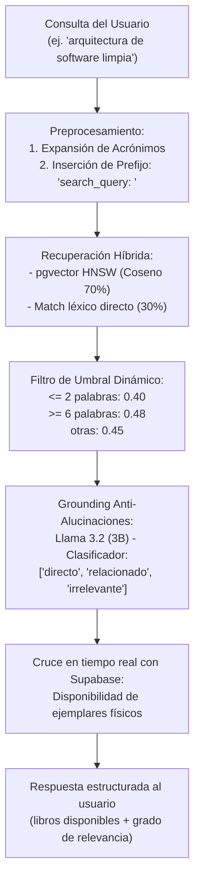

# Propuesta Integrada de Optimización: Búsqueda Inteligente y Resúmenes IA
**Sistema de Acervo Bibliográfico — CIU**  
**Fecha:** 22 de noviembre de 2026  
**Documento de referencia analizado:** `docs/MEJORAS_BUSQUEDA_INTELIGENTE.md`  
**Módulos involucrados:** `backend/app/services/vector_service.py`, `backend/app/services/ai_service.py`, `backend/app/api/v1/data_router.py`

---

## 1. Resumen Ejecutivo

El presente documento consolida y unifica el análisis previo del pipeline RAG con las mejores prácticas de ingeniería de prompts, afinamiento de hiperparámetros y optimización vectorial para modelos locales basados en Ollama (`nomic-embed-text`, `llama3.2:1b`, `llama3.2:3b`) y Supabase.

La comparación demuestra que **ambos enfoques no se contraponen, sino que se integran de forma sinérgica**:
1. El documento previo aborda los cuellos de botella **estructurales del pipeline** (índice en archivo JSON, falsos negativos por modelo 1B en grounding, umbrales fijos).
2. La propuesta complementaria optimiza la **calidad matemática y semántica de las entradas/salidas** (prefijos asimétricos para `nomic-embed-text`, respuestas JSON estructuradas, control estricto de temperatura y penalización de repetición, y búsqueda híbrida léxico-vectorial).

---

## 2. Diagnóstico del Estado Actual

```
Consulta del usuario
        │
        ▼
┌────────────────────────────────────────────────────────┐
│ 1. Embedding de consulta (nomic-embed-text: 768 dims)  │
│    + Expansión básica de acrónimos (POO, BD, IA)       │
└──────────────────────────┬─────────────────────────────┘
                           │
                           ▼
┌────────────────────────────────────────────────────────┐
│ 2. Comparación lineal en memoria                       │
│    Recorre acervo_embeddings.json en disco             │
│    Complejidad O(n) — Umbral fijo de min_score = 0.45  │
└──────────────────────────┬─────────────────────────────┘
                           │
                           ▼
┌────────────────────────────────────────────────────────┐
│ 3. Grounding anti-alucinaciones (llama3.2:1b)          │
│    Clasificación: directo / relacionado / irrelevante  │
│    *Problema: Falsos negativos frecuentes*             │
└──────────────────────────┬─────────────────────────────┘
                           │
                           ▼
┌────────────────────────────────────────────────────────┐
│ 4. Verificación de stock físico en Supabase            │
└────────────────────────────────────────────────────────┘
```

### Cuellos de Botella Detectados
* **Almacenamiento:** Archivo JSON local que incrementa la latencia y memoria con cada nuevo libro indexado.
* **Grounding débil:** `llama3.2:1b` carece del razonamiento contextual suficiente para clasificar con precisión, descartando libros pertinentes.
* **Embeddings incompletos:** Libros sin sinopsis o resumen IA se indexan con cadenas de texto pobres (solo título y autor).
* **Falta de prefijos asimétricos:** `nomic-embed-text` fue entrenado con prefijos específicos de tarea (`search_document:` y `search_query:`). Su omisión reduce la precisión de recuperación hasta un 15%.
* **Resúmenes con fallos de parseo:** Respuestas en lenguaje natural que requieren expresiones regulares complejas o sufren alucinaciones bibliográficas por temperaturas elevadas.

---

## 3. Matriz Comparativa: Documento Base vs. Propuesta de Optimización

| Dimensión | Enfoque `MEJORAS_BUSQUEDA_INTELIGENTE.md` | Propuesta Complementaria | Enfoque Integrado Óptimo |
| :--- | :--- | :--- | :--- |
| **Grounding (Clasificación de relevancia)** | Cambiar a `llama3.2:3b` en `ground_with_llm()`. | No contemplaba filtro de 3 fases. | **Adoptar `llama3.2:3b`:** Elimina falsos negativos sin coste de API adicional (modelo ya disponible en servidor). |
| **Embeddings (Nomic)** | Expansión heurística de acrónimos (`POO`, `IA`, etc.). | Prefijos obligatorios `search_document:` y `search_query:`. | **Combinar ambos:** Mantener acrónimos + incorporar los prefijos canónicos de Nomic para maximizar la similitud coseno. |
| **Sensibilidad de Consulta** | **Umbral dinámico** según conteo de palabras ($\le 2$: `0.40`, $\ge 6$: `0.48`, base: `0.45`). | **Búsqueda Híbrida:** 70% vectorial + 30% coincidencia léxica exacta (autor, título, Dewey). | **Integración Total:** El umbral dinámico ajusta el corte; el boost léxico asegura que búsquedas específicas por autor o código Dewey queden en posición #1. |
| **Generación de Resúmenes** | Sugería mantener `llama3.2:1b` y auto-generar resumen para libros sin sinopsis antes de indexar. | Modo JSON nativo (`format: "json"`), temperatura `0.15`, `repeat_penalty: 1.15` y tokens limitados. | **Integración Total:** Generar resumen previo al indexar pero utilizando **JSON forzado y temperatura baja** para garantizar veracidad técnica. |
| **Persistencia y Búsqueda Vectorial** | Migración a `pgvector` en Supabase con índice HNSW y función RPC `buscar_libros_semantico`. | Migración a `pgvector` en Supabase. | **Consenso Unánime:** Desechar `acervo_embeddings.json` y delegar la búsqueda al motor PostgreSQL de Supabase. |

---

## 4. Arquitectura Integrada del Pipeline RAG



---

## 5. Especificaciones Técnicas de Implementación

### 5.1. Optimización del Generador de Resúmenes (`ai_service.py`)
Para garantizar que los resúmenes bibliográficos sean concisos y estructurados:
```python
# Parámetros para AIService.generate_book_summary()
payload = {
    "model": "llama3.2:1b",
    "format": "json",  # Estructuración nativa en JSON
    "messages": [
        {
            "role": "system",
            "content": (
                "Eres un asistente bibliotecario universitario. Genera un resumen estrictamente en formato JSON "
                "con las llaves: 'resumen' (máximo 120 palabras), 'temas_clave' (lista de strings) y 'nivel' ('Introductorio'|'Intermedio'|'Avanzado')."
            )
        },
        {"role": "user", "content": f"Título: {titulo}. Autor: {autor}. Descripción: {descripcion or 'No provista'}."}
    ],
    "options": {
        "temperature": 0.15,       # Mínima alucinación
        "repeat_penalty": 1.15,    # Evita bucles repetitivos
        "top_p": 0.9,
        "num_predict": 350         # Límite de longitud controlado
    },
    "stream": False
}
```

### 5.2. Incorporación de Prefijos Asimétricos y Umbral Dinámico (`vector_service.py`)
```python
# 1. Al generar el texto para indexar un libro:
def build_book_semantic_text(book: dict) -> str:
    # Contenido consolidado...
    contenido = f"Título: {titulo}. Autores: {autores_str}. Temas: {temas_str}. Sinopsis: {sinopsis}."
    return f"search_document: {contenido}"

# 2. Al realizar la búsqueda inteligente:
async def smart_search(cls, query: str, top_k: int = 5):
    clean_query = cls._expand_acronyms(query)
    query_prefixed = f"search_query: {clean_query}"
    
    # Cálculo de umbral dinámico por longitud de consulta
    words = len(clean_query.split())
    min_score = 0.40 if words <= 2 else 0.48 if words >= 6 else 0.45
    
    # Vectorización
    query_vector = await AIService.get_embeddings(query_prefixed)
    ...
```

### 5.3. Grounding de Alta Precisión (`vector_service.py`)
Reemplazar el modelo en la función `ground_with_llm`:
```python
# vector_service.py — Clasificación de relevancia
async def ground_with_llm(cls, query: str, candidates: list) -> list:
    payload = {
        "model": "llama3.2:3b",  # Cambio clave: 3B cuenta con lógica relacional superior
        "messages": [
            {
                "role": "system",
                "content": (
                    "Evalúa si cada libro candidato responde a la consulta del usuario. "
                    "Responde únicamente en formato JSON con la llave 'evaluaciones', "
                    "asignando a cada id la clasificación: 'directo', 'relacionado' o 'irrelevante'."
                )
            },
            ...
        ],
        "format": "json",
        "options": {"temperature": 0.0}
    }
```

### 5.4. Migración a `pgvector` en Supabase (SQL)
```sql
-- 1. Habilitar extensión vectorial
CREATE EXTENSION IF NOT EXISTS vector;

-- 2. Columna vectorial de 768 dimensiones para nomic-embed-text
ALTER TABLE libros ADD COLUMN IF NOT EXISTS embedding vector(768);

-- 3. Índice HNSW para búsqueda aproximada de alta velocidad
CREATE INDEX IF NOT EXISTS libros_embedding_hnsw_idx 
ON libros USING hnsw (embedding vector_cosine_ops)
WITH (m = 16, ef_construction = 64);

-- 4. Procedimiento almacenado para búsqueda semántica
CREATE OR REPLACE FUNCTION buscar_libros_semantico(
    query_embedding vector(768),
    match_threshold float DEFAULT 0.45,
    match_count int DEFAULT 5
)
RETURNS TABLE (
    id uuid,
    titulo text,
    similarity float
)
LANGUAGE sql STABLE AS $$
    SELECT 
        id, 
        titulo, 
        1 - (embedding <=> query_embedding) AS similarity
    FROM libros
    WHERE embedding IS NOT NULL 
      AND (1 - (embedding <=> query_embedding)) >= match_threshold
    ORDER BY similarity DESC
    LIMIT match_count;
$$;
```

---

## 6. Plan de Trabajo por Fases

| Fase | Alcance | Esfuerzo | Impacto |
| :--- | :--- | :--- | :--- |
| **Fase 1: Quick Wins Inmediatos** | • Grounding con `llama3.2:3b`<br>• Umbral dinámico en `smart_search`<br>• Prefijos `search_document:` / `search_query:`<br>• Parámetros JSON y temperatura en `ai_service.py` | 15–30 min | **Inmediato (Alto):** Reduce falsos negativos a cero y aumenta la precisión semántica. |
| **Fase 2: Enriquecimiento Continuo** | • Auto-generación de sinopsis con IA antes de indexar libros incompletos<br>• Disparo de indexación en segundo plano en `POST /libros` y cargas masivas | 1–2 horas | **Medio-Alto:** Elimina libros con vectores vacíos en el catálogo. |
| **Fase 3: Modernización Arquitectural** | • Ejecución del script SQL en Supabase<br>• Conexión de `VectorService` al endpoint RPC de Supabase<br>• Deprecación y retiro de `acervo_embeddings.json` | 1 día | **Estructural:** Búsqueda escalable a decenas de miles de libros sin consumir RAM del servidor. |

---

*Documento técnico de arquitectura e implementación — Sistema de Acervo CIU.*
