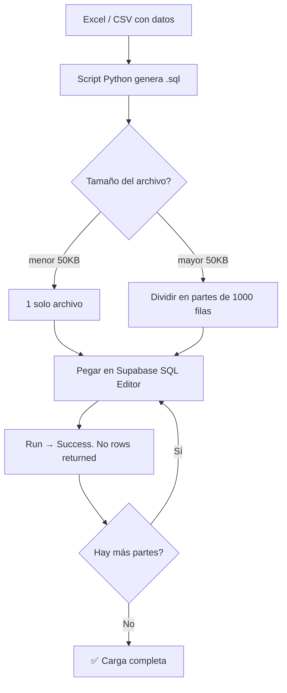

# Guía: Optimización y Cargas Masivas en Supabase (Plan Gratuito)

## ¿Por qué ocurren los timeouts?

| Límite | Valor plan gratuito | Qué lo activa |
|--------|-------------------|---------------|
| **Statement timeout** | 8 segundos | Cada query REST API individual |
| **SQL Editor timeout** | ~2 minutos | Scripts largos en el editor |
| **Conexiones simultáneas** | 60 max | Muchos requests a la vez |

---

## 1. Optimizar consultas del sistema (uso normal)

### Selecciona solo lo que necesitas
```sql
-- ❌ Lento: trae todo
GET /rest/v1/libros?select=*

-- ✅ Rápido: solo lo necesario
GET /rest/v1/libros?select=id,titulo,isbn,tipo_material_id
```

### Usa paginación siempre
```typescript
// En el frontend, nunca cargues todos los registros
const { data } = await supabase
  .from('libros')
  .select('id, titulo, isbn')
  .range(0, 49)   // página de 50
  .order('titulo')
```

### Agrega índices en columnas de búsqueda frecuente
Ejecutar en SQL Editor de Supabase:
```sql
-- Índice en ISBN (ya existe unique, está bien)
-- Índice en título para búsqueda de texto
CREATE INDEX IF NOT EXISTS idx_libros_titulo ON libros USING gin(to_tsvector('spanish', titulo));

-- Índice en tipo_material_id para filtros
CREATE INDEX IF NOT EXISTS idx_libros_tipo ON libros(tipo_material_id);

-- Índice en libro_id para ejemplares (mejora joins)
CREATE INDEX IF NOT EXISTS idx_ejemplares_libro_id ON ejemplares(libro_id);
```

---

## 2. Cargas masivas futuras — Regla de oro

> [!IMPORTANT]
> **Nunca hagas cargas masivas vía REST API (Python requests).** Siempre usa el SQL Editor de Supabase para datos grandes.

### Estrategia correcta para cualquier carga masiva

#### Paso 1: Genera el SQL desde tu script Python
```python
# En lugar de hacer requests.post() uno a uno,
# genera un archivo .sql con los VALUES

with open('carga.sql', 'w') as f:
    f.write("SET statement_timeout = '0';\n\n")
    f.write("INSERT INTO libros (isbn, titulo, ...) VALUES\n")
    
    rows = []
    for libro in libros:
        isbn = libro['isbn'].replace("'", "''")
        titulo = libro['titulo'].replace("'", "''")
        rows.append(f"  ('{isbn}', '{titulo}', ...)")
    
    f.write(",\n".join(rows))
    f.write("\nON CONFLICT (isbn) DO NOTHING;\n")
```

#### Paso 2: Divide en partes de ~1,000 filas
```python
PARTE_SIZE = 1000  # filas por archivo SQL
# Cada parte pesa ~50 KB → ideal para el SQL Editor
```

#### Paso 3: Ejecuta en SQL Editor
- Una parte a la vez
- Espera "Success. No rows returned" antes de la siguiente
- Usa `ON CONFLICT ... DO NOTHING` para que sea idempotente (re-ejecutable)

---

## 3. Template de script de carga masiva seguro

```python
"""
Template: carga_masiva_segura.py
Genera archivos SQL listos para pegar en Supabase SQL Editor.
"""
import openpyxl, os

def generar_sql_desde_excel(excel_path, out_dir, tabla, columnas, parte_size=1000):
    """
    excel_path  : ruta al .xlsx
    out_dir     : carpeta de salida para los .sql
    tabla       : nombre de la tabla destino
    columnas    : lista de nombres de columnas a insertar
    parte_size  : filas por archivo (default: 1000)
    """
    os.makedirs(out_dir, exist_ok=True)
    wb = openpyxl.load_workbook(excel_path)
    ws = wb.active
    headers = [cell.value for cell in ws[1]]
    
    # Leer filas
    all_rows = []
    for row in ws.iter_rows(min_row=2, values_only=True):
        vals = []
        for col_name in columnas:
            idx = headers.index(col_name)
            v = row[idx]
            if v is None:
                vals.append('NULL')
            else:
                vals.append(f"'{str(v).replace(chr(39), chr(39)*2)}'")
        all_rows.append(f"  ({', '.join(vals)})")
    
    # Dividir en partes
    partes = [all_rows[i:i+parte_size] for i in range(0, len(all_rows), parte_size)]
    
    for idx, parte in enumerate(partes, start=1):
        col_list = ', '.join(columnas)
        sql = f"""-- Parte {idx} de {len(partes)}
SET statement_timeout = '0';

INSERT INTO {tabla} ({col_list})
VALUES
{chr(10).join(parte)}
ON CONFLICT DO NOTHING;
"""
        fname = os.path.join(out_dir, f'carga_parte_{idx:02d}.sql')
        with open(fname, 'w', encoding='utf-8') as f:
            f.write(sql)
        print(f"Parte {idx:02d}: {len(parte)} filas → {fname}")
    
    print(f"\nTotal: {len(partes)} archivos generados")
```

---

## 4. Resumen visual del flujo correcto



> [!TIP]
> **El tamaño ideal por parte es 500-1,000 filas (~50 KB).** Así cada query tarda 1-3 segundos en Supabase, muy por debajo del límite de 8s de la REST API y del límite de 2 min del SQL Editor.

> [!NOTE]
> `ON CONFLICT DO NOTHING` hace que el script sea **idempotente** — puedes ejecutarlo varias veces sin duplicar datos. Siempre inclúyelo en cargas masivas.
